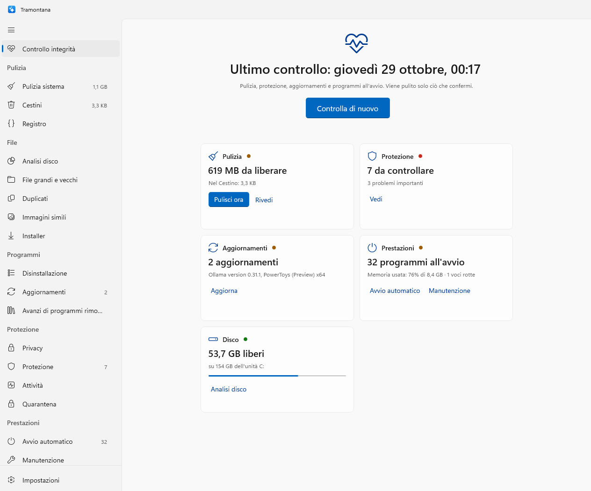
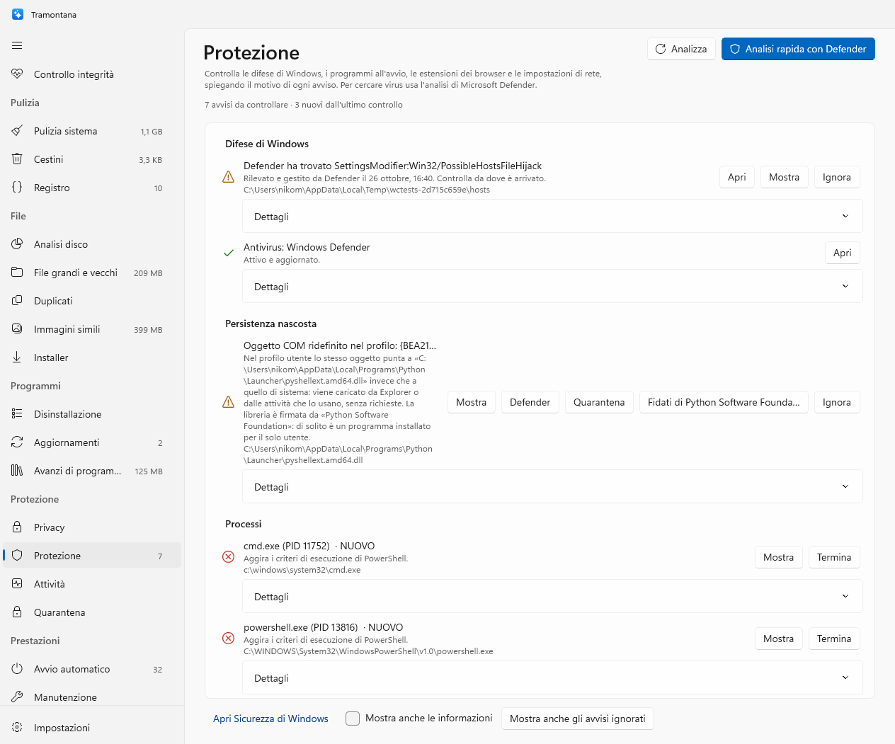

# Tramontana

La tramontana è il vento del nord, secco e freddo, che spazza via le nuvole e lascia il cielo terso. Tramontana è un'app Windows indipendente e open source, scritta in C# e WinUI 3, che riunisce in una sola finestra pulizia, spazio, programmi, privacy, protezione e prestazioni del PC. Nessun abbonamento, nessuna telemetria, nessun servizio sempre acceso: ogni operazione parte da un clic, viene mostrata prima di essere eseguita e finisce nel registro delle operazioni. È la gemella Windows di [Maestrale](https://github.com/nicomil/maestrale).

> Sito di presentazione con screenshot: **https://nicomil.github.io/tramontana/**
>
> **Scarica**: [Tramontana-Setup-0.3.0-x64.exe](https://github.com/nicomil/tramontana/releases/download/v0.3.0/Tramontana-Setup-0.3.0-x64.exe) (circa 100 MB) · [tutte le versioni](https://github.com/nicomil/tramontana/releases) · Windows 10 (2004) o Windows 11, x64





## In breve

| | |
|---|---|
| Piattaforma | Windows 10 2004 o successivo, Windows 11 (x64; build ARM64 da sorgente) |
| Linguaggio | C# 14, .NET 10, WinUI 3 (Windows App SDK), xUnit |
| Codice | 107 file C#, circa 15.000 righe, 157 test automatici |
| Firma | release firmate da SignPath Foundation dopo approvazione manuale; build locali con un certificato del PC di compilazione |
| Dipendenze esterne | solo Windows App SDK; winget, Defender e gli strumenti di Windows vengono usati, non inclusi |
| Licenza | MIT |

## Funzioni

### Pulizia
- **Pulizia sistema**: temporanei, cache di miniature, icone e shader, segnalazioni errori, dump, log, Windows Update, Prefetch, avanzi di installazione di Windows, cache dei browser (Chrome, Edge, Brave, Vivaldi, Opera, Arc, Firefox e derivati), delle app Electron, di Teams, Spotify, Steam, Adobe e degli strumenti di sviluppo. Le cache dei programmi aperti sono escluse e il controllo è ripetuto subito prima della pulizia.
- **Cestini**: contenuto del Cestino di ogni unità, con posizione originale e data.
- **Registro**: solo voci verso programmi e file che non esistono più (voci di disinstallazione, App Paths, SharedDLLs, cache MUI), con backup `.reg` prima di ogni modifica.

### File
- **Analisi disco**: mappa ad albero dello spazio, veloce (handle e ID dei file, in parallelo).
- **File grandi e vecchi**, **download non usati**, **duplicati**, **immagini simili**, **installer** già usati. I file solo-cloud di OneDrive non vengono mai letti.

### Programmi
- **Disinstallazione** con ricerca degli avanzi (cartella rimasta, voce in App installate, collegamenti rotti), app dello Store, ultimo uso.
- **Aggiornamenti** con winget: un programma aperto viene segnalato prima del download, i pacchetti dello Store che non si applicano a un'installazione classica vengono riprovati dalla fonte giusta.
- **Avanzi di programmi rimossi**: cartelle che nessun programma installato o processo reclama più.

### Protezione
- **Privacy**: cronologia, cookie, download, moduli, sessioni dei browser (le password solo contate, mai lette); file recenti, Jump List, ricerche di Explorer, Appunti, reti Wi‑Fi; app che hanno usato fotocamera, microfono e posizione.
- **Protezione**: 17 controlli (Defender, difese e impostazioni, persistenza, programmi recenti, browser, certificati radice, rete, processi, firme con LOLDrivers, hash e YARA). Ogni avviso ha evidenze e «nuovo dall'ultimo controllo»; controllo approfondito con l'helper in sola lettura; correzioni del registro con backup; analisi mirata di Defender; rapporto Markdown.
- **Attività**: processi in tempo reale con CPU, memoria, disco, connessioni, firma e giudizio di Protezione; avviso nell'area di notifica quando un processo non Microsoft satura un core per oltre un minuto.
- **Quarantena**: file messi da parte da Protezione, senza permessi di esecuzione e con `Zone.Identifier`; ripristino ed eliminazione (di sistema tramite l'helper).

### Prestazioni
- **Avvio automatico** (come Gestione attività, sempre reversibile), attività pianificate, servizi non Microsoft, con firma verificata senza rete.
- **Manutenzione**: DNS, memoria, cache delle icone, Esplora risorse, Pulizia di Windows (Windows.old), DISM, SFC, Ottimizzazione recapito, ottimizzazione unità, punto di ripristino, cancellazione dello spazio libero.

### Trasversali
- **Controllo integrità**: pulizia, Cestini, protezione, aggiornamenti e avvio automatico in un clic, con riepilogo. Pulisce solo i file preselezionati dell'utente, dopo conferma.
- Icona nell'area di notifica con CPU, memoria, disco e batteria; analisi pianificata con notifica; avvio con Windows; modalità predefinita (Cestino, eliminazione, prova).
- `trcli`: le stesse scansioni dal terminale, in sola lettura.

Fuori dal perimetro, di proposito: aggiornamento dei driver (serve un database proprietario e può rendere il PC instabile), pulizia del registro «aggressiva» (Microsoft la sconsiglia), antivirus proprio (c'è Defender).

## Come è fatto

```
Tramontana.exe (WinUI 3)
 ├─ Tramontana.Core       file system tramite handle, rimozione sicura, Cestino, regole, registro di sistema, firme, log
 ├─ Tramontana.Modules    un modulo per funzione (Apps/, Protection/, System/, Privacy/, Performance/, Helper/…)
 ├─ trhelper.exe          l'unica parte che gira come amministratore, su named pipe
 └─ trcli.exe             scansioni dal terminale
```

- Ogni modulo produce un rapporto di categorie e voci con dimensione, rischio e preselezione. L'interfaccia è la stessa per tutti.
- `SafeRemover` è l'unico punto che rimuove file. Accetta solo percorsi dentro le cartelle consentite, apre ogni cartella relativamente alla precedente senza seguire junction o link, rifiuta i file di TrustedInstaller e di Windows Resource Protection, e registra tutto in `%LOCALAPPDATA%\Tramontana\Logs\operations.log`.
- Le operazioni da amministratore sono un elenco chiuso. L'app verifica l'hash dell'helper collegato alla pipe; l'helper verifica nome, cartella, utente, hash e firma dell'app che lo chiama, e ricontrolla da sé ogni richiesta.
- Le scelte di progetto sono in `docs/spec/`; la revisione di sicurezza completa, con ogni finding e la sua mitigazione, in `docs/security-review.md`.

## Installazione dal setup

1. Scarica `Tramontana-Setup-<versione>-x64.exe` dall'[ultima release](https://github.com/nicomil/tramontana/releases). Accanto c'è `SHA256SUMS.txt` per verificarlo.
2. Apri il setup: procedura guidata classica, chiede l'amministratore, installa in `C:\Program Files\Tramontana`, aggiunge Tramontana al menu Start (e, se scelto, al desktop) e ad App installate. Non serve installare .NET: l'app contiene tutto.
3. Per aggiornare basta lanciare il setup nuovo sopra quello vecchio. Per toglierlo: Impostazioni → App → Tramontana → Disinstalla. Toglie anche l'analisi pianificata e l'avvio con Windows; i dati in `%LOCALAPPDATA%\Tramontana` restano.

Fino alla versione 0.2 l'app si chiamava WinCleaner. Dalla 0.3 il nome è Tramontana: il setup rimuove da solo la vecchia installazione e al primo avvio l'app sposta impostazioni, registro delle operazioni, backup, regole e quarantena da `%LOCALAPPDATA%\WinCleaner` a `%LOCALAPPDATA%\Tramontana` (l'helper fa lo stesso con `C:\ProgramData\WinCleaner`). L'analisi pianificata e l'avvio con Windows vanno riattivati dalle Impostazioni.

**SmartScreen al primo avvio.** Le release sono firmate con il certificato di SignPath Foundation dopo approvazione manuale. Finché una release è marcata «pre-release» il setup non è ancora firmato e Windows può mostrare «Windows ha protetto il PC»: «Ulteriori informazioni» → «Esegui comunque», dopo aver confrontato lo SHA-256 con `SHA256SUMS.txt`.

## Build, test e installazione da sorgente

Requisiti: .NET 10 SDK (`winget install Microsoft.DotNet.SDK.10`). Visual Studio non serve. Inno Setup 6 (`winget install JRSoftware.InnoSetup`) solo per costruire l'installer.

```powershell
# test (157, girano su Windows)
dotnet test tests\Tramontana.Tests -p:Platform=x64

# cartella pronta in artifacts\Tramontana-x64, firmata con il certificato locale (scripts\new-signing-cert.ps1 lo crea una volta)
powershell -ExecutionPolicy Bypass -File scripts\publish.ps1

# installazione in Program Files, con voce in App installate
powershell -ExecutionPolicy Bypass -File scripts\install.ps1

# installer artifacts\Tramontana-Setup-<versione>-x64.exe (-Arch arm64 per i PC ARM), oppure uno zip con Installa.cmd
powershell -ExecutionPolicy Bypass -File scripts\publish.ps1 -Setup
powershell -ExecutionPolicy Bypass -File scripts\publish.ps1 -Zip

# scansioni dal terminale (sola lettura, salvo clean, che di default è una prova)
trcli scan system-junk|recycle-bin|registry|large-old-files|duplicates|similar-images|installers|orphans [--items]
trcli clean system-junk --mode dry|recycle|delete
trcli lens C:\ | apps | leftovers <nome> | updates | privacy | startup | protection [--evidence --all --report] | processes | signatures | monitor
```

Dal Mac, con il PC Windows raggiungibile via SSH (`TR_HOST`, predefinito `blackframe-minipc`), `scripts/remote.sh` copia l'albero e lancia lo stesso comando lì:

```bash
scripts/remote.sh dotnet test tests/Tramontana.Tests -p:Platform=x64
scripts/remote.sh "powershell -ExecutionPolicy Bypass -File scripts\publish.ps1 -Setup"
```

Gli screenshot di README e sito si rigenerano con `Tramontana.exe --tour <cartella>`: apre ogni pagina, aspetta i dati e salva un PNG per pagina (`--smoke` fa lo stesso giro senza immagini, per il controllo di fine build).

## Sicurezza

Principi validi ovunque:
- Di default i file vanno nel **Cestino** (restano ripristinabili da Esplora risorse). La modalità **Prova** non rimuove nulla. Le categorie a rischio alto non sono mai preselezionate.
- Niente viene rimosso senza una conferma che mostra elementi e dimensione totale.
- Ogni operazione, riuscita o rifiutata, è nel registro delle operazioni (quelle dell'helper in `C:\ProgramData\Tramontana\Helper\Logs`).
- Tutto ciò che l'app legge da disco o da un comando (output, manifest, regole YARA, XML) è trattato come dato: parsato con limiti di dimensione, mai eseguito. Ogni programma esterno (reg, netsh, winget, yara, MpCmdRun…) parte con il percorso assoluto, argomenti separati e l'ambiente ripulito dalle variabili con cui un processo a livello utente può far caricare codice (profiler .NET, startup hook, moduli PowerShell del profilo).

<details>
<summary>Dettagli per modulo</summary>

- **Percorsi e handle**: si rimuove solo dentro cartelle consentite (`Roots`), mai la cartella stessa. I percorsi devono essere percorsi locali semplici: niente `\\?\`, UNC, flussi alternativi (`file:stream`), `.` o `..`, nomi che finiscono con punto o spazio. La cartella consentita viene aperta e ogni cartella sotto viene aperta relativamente alla precedente (`NtCreateFile` con handle radice), senza mai seguire junction, link simbolici o punti di montaggio: se una cartella viene scambiata con un collegamento mentre l'operazione è in corso, l'operazione fallisce invece di finire altrove. I file si eliminano tramite il loro handle (semantica POSIX) e si spostano nel Cestino rinominando l'handle nella cartella del Cestino, senza mai sostituire un elemento esistente; accanto viene scritto il file `$I` nel formato di Explorer, così «Ripristina» funziona. Dentro una cartella da eliminare i collegamenti vengono tolti come collegamenti: il loro contenuto non viene mai letto, misurato o cancellato.
- **File di Windows**: i file di proprietà di **TrustedInstaller** e quelli protetti da **Windows Resource Protection** vengono rifiutati. I dati di Tramontana (log, backup) non vengono mai puliti. I file in uso vengono lasciati al loro posto e contati.
- **Pulizia sistema**: le cache di un programma aperto vengono saltate (browser, Teams, Spotify, le app Electron con il nome della loro cartella…) e il controllo viene ripetuto subito prima della pulizia.
- **Registro di sistema**: si tocca solo un elenco chiuso di posti (chiavi dei programmi sotto `Software`, e liste di Windows come Uninstall, App Paths, Run, SharedDLLs, MuiCache, cronologie di Explorer); mai `HKLM\SYSTEM`, `Classes`, `Policies` o la chiave `Microsoft`. Ogni chiave viene esportata in un file `.reg` prima di toglierla (cartella `%LOCALAPPDATA%\Tramontana\Backups`).
- **Browser**: si cancellano righe dai database solo a browser chiuso, dopo una copia completa fatta da SQLite (`VACUUM INTO`, include le modifiche nel file `-wal`), riletta e messa nel Cestino. Le istruzioni per tabelle assenti in quella versione del browser vengono saltate, così la transazione non fallisce a metà. Le password non vengono mai lette.
- **Duplicati**: sono preselezionate solo le copie nei Download; prima di pulire viene ricontrollato che la copia che resta esista e sia identica. Non si può togliere la copia da tenere né tutte le copie di un gruppo.
- **Disinstallazione**: usa il programma di disinstallazione del produttore (o `msiexec /x`), chiude il programma prima e aspetta anche le copie del disinstallatore lanciate da `%TEMP%`. Gli avanzi si cercano con nomi esatti (programma, cartella, editore), mai dentro la cartella di un altro programma; sono preselezionati solo la cartella rimasta, la voce rimasta in App installate e i collegamenti rotti. L'elenco è bloccato durante l'operazione.
- **Aggiornamenti**: prima di ogni aggiornamento l'app cerca i processi in esecuzione dalla cartella del programma (solo quella, mai cartelle condivise) e chiede se chiuderli; un installer silenzioso non può sostituire un file in uso. I codici di errore di winget vengono tradotti in frasi, non in percorsi di log.
- **Installer**: preselezionati solo se Windows li ha segnati come scaricati da internet (Mark of the Web) e lo stesso programma è installato in versione uguale o più recente.
- **Avvio automatico**: disattivare usa le chiavi `StartupApproved`, come Gestione attività, ed è sempre reversibile. Le attività sotto `\Microsoft\` e i servizi di Microsoft non vengono mostrati né toccati.
- **Helper di sistema** (`trhelper.exe`): è l'unica parte che gira come amministratore, con una sola richiesta UAC per sessione. Comunica su una named pipe accessibile solo all'utente, con un'unica connessione; l'app verifica che il processo collegato esegua un file con lo SHA-256 atteso, e l'helper verifica che la pipe appartenga a `Tramontana.exe` nella sua stessa cartella, avviato dallo stesso utente, e nella versione pubblicata che `Tramontana.dll` abbia lo SHA-256 compilato dentro l'helper da `publish.ps1` e che `Tramontana.exe` porti la firma attesa (`trhelper.exe --identity` li mostra): un altro programma che lo avviasse con una richiesta UAC a nome di Tramontana viene rifiutato. Accetta un elenco chiuso di operazioni e ricontrolla tutto da sé: cartelle di sistema consentite, elenco di cartelle condivise mai toccate (WindowsApps, Common Files, `ProgramData\Microsoft`…), TrustedInstaller, WRP, elenco del registro; le cartelle di programmi ancora installati, o da cui gira un processo, non si toccano; attività, servizi, voci di avvio e reti Wi‑Fi devono essere tra quelli che l'helper stesso trova sul sistema. Tutto ciò che scrive da amministratore (log, backup `.reg`, quarantena di sistema, pin) sta in `C:\ProgramData\Tramontana`, in cartelle create con permessi espliciti per soli amministratori e ricontrollate a ogni uso (proprietario, DACL, niente junction). Defender e le sottoscrizioni WMI si pilotano con metodi WMI e mai con una stringa PowerShell, le DLL si caricano solo dalla sua cartella e da System32. Si chiude dopo 10 minuti senza richieste. Fuori da Program Files (sviluppo) l'helper funziona ma scrive nel log che la cartella non è protetta.
- **Protezione** (`docs/spec/protection-upgrade.md`): la scansione standard non chiede mai l'amministratore. Il controllo approfondito usa una sola operazione dell'helper di sola lettura (`CollectSystemEvidence`): query WMI e comandi fissi. Le modifiche al registro passano da un elenco esatto di voci (`ProtectionRegistry`), con file `.reg` prima di ogni cambio; i valori che Windows richiede (Shell, Userinit, AppInit_DLLs) vengono riportati al valore predefinito, non cancellati. La quarantena sposta i file tramite handle, toglie i permessi di esecuzione, aggiunge `Zone.Identifier`; il ripristino rimette un elemento solo dentro le cartelle da cui la quarantena può prendere, aprendo la destinazione un nome alla volta senza seguire collegamenti, e un record dell'indice che non punta alla propria cartella viene ignorato. L'helper termina un processo solo se esegue ancora l'immagine indicata e mai i processi critici o i componenti firmati di Windows. Le firme: un file senza firma dentro `C:\Windows` viene cercato nei cataloghi di Windows, non creduto per il percorso (`Windows\Temp`, `Tasks` e le altre cartelle scrivibili dagli utenti non godono di fiducia); «Microsoft» vale solo quando la catena del certificato finisce in una radice Microsoft. Regole YARA, hash e LOLDrivers non vengono scaricati: l'utente li aggiunge dalle Impostazioni e confronta lo SHA-256 mostrato; `yara64.exe` ufficiale va messo nella stessa cartella. Regole e `yara64.exe` si confermano come amministratore: i loro SHA-256 finiscono in `ProgramData\Tramontana\Pins`, che solo gli amministratori scrivono, e a ogni scansione un file cambiato viene segnalato e non usato (un `yara64.exe` cambiato è un Pericolo e non parte). «Ignora» nasconde solo avvisi e informazioni, mai un Pericolo.
- **Analisi disco**: «Apri» apre solo documenti e media, mai eseguibili o script.
- **Pubblicazione e firma**: `publish.ps1` ripristina i pacchetti in modalità bloccata (`packages.lock.json`), si ferma se un pacchetto ha un avviso di sicurezza, e firma con Authenticode app, helper, DLL del progetto, setup e disinstallatore con il certificato «Tramontana Code Signing» del PC di compilazione (`scripts\new-signing-cert.ps1` lo crea una volta, chiave non esportabile; `-SignThumbprint` per usarne un altro, `-NoSign` solo per prove). L'impronta del certificato e lo SHA-256 di `Tramontana.dll` vengono compilati dentro `trhelper.exe`, che serve solo un `Tramontana.exe` con quella firma intatta; `install.ps1` rifiuta file non firmati o modificati dopo la firma. Un certificato autofirmato dà integrità e autenticazione dell'helper; non dà la reputazione SmartScreen. Le release ufficiali vengono invece firmate da SignPath (vedi «Code signing policy»): il workflow compila con `-NoSign -ExpectedSigner <impronta>`, così l'helper è legato al certificato di SignPath, manda i file a firmare e costruisce il setup dai file firmati (`-SetupOnly`).
- **Test**: la suite non tocca i dati di Tramontana della macchina su cui gira (cartelle utente e di sistema reindirizzate in `%TEMP%\trtests-data`).

</details>

## Code signing policy

Free code signing provided by [SignPath.io](https://signpath.io), certificate by [SignPath Foundation](https://signpath.org).

Releases are built by [GitHub Actions](.github/workflows/release.yml) from a `v<version>` tag of this repository and signed by SignPath after manual approval; builds made on a developer's PC are never signed with that certificate. The full policy, the team roles, the privacy statement (Tramontana sends no data) and the uninstall instructions are in [docs/code-signing-policy.md](docs/code-signing-policy.md). Downloads: [Releases](https://github.com/nicomil/tramontana/releases).

## Stato

| Milestone | Stato |
|---|---|
| M0 ambiente (.NET 10 sul mini PC, sync via SSH) | fatto |
| M1 core (handle, Cestino, regole), pulizia sistema, cestini | fatto |
| M2 analisi disco, file grandi e vecchi, duplicati, immagini simili | fatto |
| M3 programmi, avanzi, aggiornamenti winget, installer, orfani | fatto |
| M4 privacy, avvio automatico, manutenzione, protezione, registro, helper | fatto |
| M5 app WinUI 3, area di notifica, pianificazione, impostazioni | fatto |
| M6 installazione in Program Files (setup Inno Setup, o script PowerShell) | fatto |
| M7 protezione avanzata (Defender, persistenza, processi, quarantena, firme) | fatto |
| Nuovo nome Tramontana (0.3), sito, screenshot, migrazione dei dati | fatto |
| Revisione di sicurezza completa e mitigazioni (`docs/security-review.md`) | fatto |
| Release firmate (SignPath Foundation, CI su GitHub Actions) | in attesa dell'approvazione |

157 test automatici coprono le parti di sicurezza: junction nel percorso e dentro le cartelle, file in uso, sola lettura, Cestino visibile in Explorer, backup del registro e dei database, regole dentro le radici, limiti dell'helper, cartelle solo-amministratori, record di quarantena falsi, chiamante dell'helper, ambiente ripulito, fiducia per catalogo e non per percorso, processi del programma da aggiornare.

## Licenza

Tramontana è progettato e sviluppato da Nicola Milella ed è distribuito con licenza [MIT](LICENSE).
